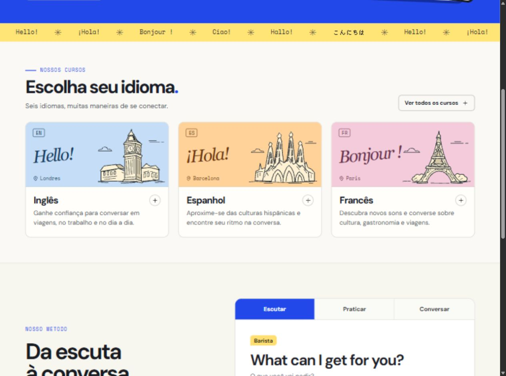

# Verbo · Escola de idiomas

Aplicação em React para explorar seis idiomas, experimentar uma atividade de conversação e agendar uma aula online de demonstração. O site adapta o catálogo, a navegação e o formulário a telas de celular, tablet e desktop.



## Executar localmente

Use Node.js 22.12 ou superior e npm.

```sh
npm ci
npm run dev
```

Abra o endereço local exibido pelo Vite. Para executar os testes e conferir a versão de produção:

```sh
npm test
npm run build
npm run preview
```

## Organização

| Diretório | Responsabilidade |
| --- | --- |
| `src/components/` | Navegação, identidade visual, catálogo, atividade de conversação e diálogos de curso e agendamento. |
| `src/data/` | Dados fictícios dos cursos, níveis e objetivos de aprendizagem. |
| `src/services/` | API assíncrona simulada para consultar cursos e horários, validar dados e registrar reservas. |
| `src/styles/` | Estilos responsivos da página, das atividades e dos formulários. |
| `public/images/` | Fotografia editorial em WebP e seis ilustrações vetoriais próprias. |
| `tests/` | Testes da camada de serviços com o executor nativo do Node.js. |

## Backend simulado

`listCourses()` retorna o catálogo. `getSlots(courseId)` calcula os horários disponíveis nos próximos quatro dias úteis no fuso do dispositivo. `bookTrial({ courseId, slotId, name, email })` valida a reserva, verifica a disponibilidade e salva o resultado no armazenamento local.

Essas operações simulam latência. As reservas existem apenas no navegador em que foram criadas. Para reiniciar a demonstração, remova a chave `verbo.trial-bookings.v1` do armazenamento local desse site. Uma API real pode substituir as três funções em `src/services/schoolApi.js`, preservando o contrato com a interface.

## Identidade visual

O nome **Verbo** remete à ação de falar. O símbolo combina dois balões de conversa e aparece na marca e no [favicon](public/favicon.svg). A fotografia foi gerada com ImageGen para este projeto. [Direção de arte e prompt da fotografia](docs/fotografia.md).

## Publicação na Vercel

O projeto usa o preset Vite, o comando `npm run build` e o diretório de saída `dist`. As dependências e fontes estão declaradas no projeto. A demonstração funciona sem configurar variáveis de ambiente.
